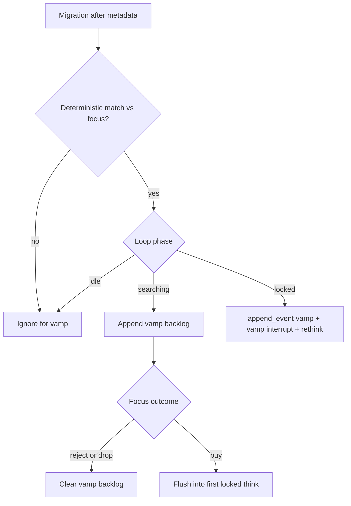

# Vamp / copycat scanner — implementation plan

Design for Phase 5 tool 6. **Built** as a fed/interrupt scanner (`src/archetype/tools/vamp.py`). This doc remains the behaviour brief.

`docs/all-tools.md` §6, `docs/PROJECT_OVERVIEW.md`, and the catalogue line in `trader.md` track the fed/interrupt labelling.

---

## 1. Purpose

While the agent is on one coin, a newer migrate can steal the same narrative (a “vamp”). That can dump the focused coin. The scanner gives situational awareness without opening a second trading universe.

The agent **does not buy** the vamp from this alert. If the vamp looks like a **better** same-narrative play, the agent should **sell the focused coin ASAP**, finish the trade, and move on via normal backlog FIFO.

### Narrative rule (what counts)

A vamp is a coin that copies the **same narrative**, not merely the same person or company.

**Not a vamp**

1. Focus: “artificial inu”, ticker `INU`, holder-rewards pump, linked to an Elon/Tesla tweet about a robot dog.
2. Other migrate: “fartster”, linked to an Elon/Tesla tweet about a Roadster that farts liquid gas.

Same person/company, **different** meme/event → do **not** alert.

**Is a vamp**

1. Same focus coin as above.
2. Other migrate: also named “artificial inu” (or clearly the same name), ticker `AI`, paired to TESLAx, **same** linked tweet.

Same narrative, often a stronger packaging → alert. Agent should lean toward selling focus if the copy looks better.

Deterministic v1 approximates this with name / ticker / shared social URLs / quote pairing. Full tweet reply/quote graphs wait for X tools.

---

## 2. Non-goals (v1)

- Not agent-callable (`{"action":"vamp"}` does not exist).
- No auto-sell. Agent sells; system never force-closes on vamp.
- Do not buy the vamp mint from this path.
- No LLM / Gemini narrative judge in the detector.
- No X reply/quote-to-focus-tweet matching yet.
- No scan of coins that fail on-chain **before** metadata exists (no name/socials to compare).
- Do not treat “same KOL / same company, different meme” as a hit.

---

## 3. Label and how it reaches the agent

| Aspect | Choice |
|--------|--------|
| Catalogue | Informational line only (fed/interrupt). Rank ~**0.9** — urgent when it fires. |
| Searching | Detect + **buffer**. No interrupt. No prompt spam. |
| After buy | Flush buffer into the **first locked think**. |
| Reject / drop without buy | **Clear** the vamp backlog. |
| Locked + new match | `append_event` + **cancel in-flight think** with a **vamp** interrupt reason (not TP/SL), then rethink with the alert. Bag stays open. |

Price-change stays non-interrupt. Vamp is the exception: same-narrative competition is time-sensitive once we hold.

---

## 4. Phase behavior



### Searching

- Matcher still runs against the focused coin.
- Hits go to an in-memory **vamp backlog** only.
- Do not interrupt Ollama. Do not inject into searching thinks.

### Buy

- On successful buy / transition to locked: **flush** the vamp backlog into focus memory as one or more `vamp` events (deduped by mint).
- Those lines appear on the **first locked think** (and stay in the recent-events window).

### Reject / forced reject / drop focus without buy

- Clear the vamp backlog for that focus.
- Idle / no focus: do not buffer; clear if anything is left.

### Locked

- New match: write the event, emit live `vamp`, set **vamp interrupt**, cancel in-flight model call if any.
- Next tick: think again with the vamp block in recent events.
- Do **not** route to thesis/close (that path is TP/SL only).

---

## 5. Where detection hooks in

Migrations already go: ingest → repair → `run_full_filters` → backlog enqueue on PASS.

**Compare on filter PASS** in `src/archetype/api/app.py` after `enqueue_passed` (candidate already has name, symbol, socials from the full filter path).

- **v1 product rule:** only **passed** migrations (not socials-fail rejects). Matches the live “daemon migrations that enter the backlog” feed.
- Skip when idle / no focus.
- Need a **focus snapshot** from the running loop: phase, focus mint, focus `coin_info` (name, symbol, twitter, telegram, website, quote_mint / quote_symbol, description optional).

Focus today: `AgentLoop.state` + `AgentToolkit.focus_mint` + graph `state["coin"]` from backlog `coin_info`.

---

## 6. Deterministic matcher (v1)

Module sketch: `src/archetype/tools/vamp.py`, thin call from the filter / `app.py` hook.

### Inputs

- Focus: `coin_info` for the focused mint.
- Candidate: mint, name, symbol, twitter, telegram, website, quote_mint / quote_symbol, optional description.

Skip if candidate mint equals focus mint.

### Normalize

- Name / ticker: lowercase; strip spaces and common punctuation.
- Socials: same idea as `dex.py` `_norm` — `twitter.com` ≡ `x.com`, strip trailing slash, lowercase host/path.
- Ticker compare uses the normalized symbol string.

### Fire rules (any strong hit → candidate)

| Signal | Rule |
|--------|------|
| **Ticker** | Exact match after normalize, **or** one contains the other when both length ≥ 3. |
| **Name** | Exact after normalize, **or** high token overlap / containment after dropping stopwords (`the`, `a`, `coin`, `token`, `inu` only as a lone token is weak — prefer multi-token / shared distinctive tokens). |
| **Social URL** | Any shared normalized twitter, telegram, or website (exact URL / same status id). Counts as a match signal only — we do **not** score reply/quote graphs yet. |
| **Pairing (display)** | If the candidate has a non-SOL quote, show `pairing:` for the agent. **Never** set a programmatic “stronger” flag — the agent judges pairing vs focus. |

Shared twitter **status** URL (same `/status/id`) is a strong social hit. Shared profile-only URL is weaker but still counts in v1 (agent judges). Same host with unrelated paths does not match after path-aware norm.

### Output struct (buffer + internal payload)

```text
mint          — kept in memory/payload for dismiss / logging; NOT shown to the agent
name, symbol
matched_on: ["ticker" | "name" | "twitter" | "telegram" | "website", ...]
quote_label: e.g. TESLAx or null (agent-facing only when set)
why: short backend log line
```

No full second opening card. No wallet lists. No buy size. No `stronger_pairing`. No overlap URL dump in the agent block.

---

## 7. Vamp backlog

| Property | Choice |
|----------|--------|
| Storage | In-memory on daemon / loop (not SQLite v1) |
| Key | Candidate mint; dedupe |
| Cap | ~10; drop oldest on overflow |
| Scope | Tied to **current focus mint**; changing focus clears |
| Owner | `VampBuffer` on `AgentLoop` / app state; filter hook reads focus snapshot and writes hits |

### API sketch

- `observe(focus_phase, focus_coin, candidate) -> hit | None`
- `buffer_add(hit)` when phase is searching
- `flush() -> list[hit]` on buy (then clear)
- `clear()` on reject / drop / idle
- `alert_locked(hit)` when phase is locked (event + interrupt)

---

## 8. Loop / abort design

Today: `LoopDeps.abort` is a bare `asyncio.Event`. TP/SL sets it; `_think` treats abort as **`route: "close"`**.

Vamp must **not** reuse that meaning.

### Preferred shape

- `abort_reason: None | "tpsl" | "vamp"` (or a separate `vamp_interrupt` event plus keep TP/SL on `abort`).
- `_call_model` still cancels the in-flight `ainvoke` when either fires.
- After cancel:
  - **`tpsl`** → existing close / thesis path when bag flat.
  - **`vamp`** → clear reason, `route: "stop"` (or equivalent), **next tick `_think`** with vamp already in `FocusMemory`. Position unchanged.

### Locked match sequence

1. `memory.append_event(focus_mint, "vamp", {text, ...})`
2. Live `_emit(..., kind="vamp")` for `--follow`
3. Set vamp interrupt
4. In-flight think cancels (if any)
5. Next think sees the vamp block via `_event_line` (full text block, same pattern as `safety` / `dex` / `wallets`)

### Searching

Never set vamp interrupt.

---

## 9. Agent-facing copy

### Catalogue (informational, not callable)

Suggested line (rank ~0.9), locked prompt only or always visible but only meaningful after buy:

```text
vamp - 0.9 - fed alert when a new migrate looks like the same narrative as your coin (name/ticker/socials). if it looks stronger, sell now and leave. do not buy the vamp mint from this alert.
```

Exact wording can be tightened when wiring `trader.md`. Searching catalogue does not need a callable example JSON.

### Alert block

Header verb follows focus status: **selling** when holding / locked (including flush-after-buy); **rejecting** if shown before a buy.

```text
Vamp alert - another coin has migrated which may be similar to the coin you are currently focused on, assess the below details and decide whether it is worth selling your current coin
name: Artificial Inu  symbol: AI (compare the name and symbol of this coin to your current coin's name and symbol, are they better?)
matched: name, twitter (these are the fields that matched to your current coin)
pairing: TESLAx (evaluate if this pairing is better than the pairing of your current coin (if it has one) in relation to the narrative)
in your json reply, fill reasoning with why you sell, hold, reject, or otherwise keep this focus after this vamp alert
```

- Field notes use the same bracket style as other tools (`explain=True` on first delivery; compact values later).
- No mint, overlap, stronger_pairing, or trailing `note:` line on the agent block.
- When a vamp event is in the prompt window, the decision grammar requires non-empty `reasoning`, and the loop rejects blank/echo-stripped reasons.
- Multiple buffered hits flush as **one block per mint**, newest first, stay inside the last-5 events cap (if many, keep highest-signal / most recent).

### What the agent decides

1. Is this really the same narrative? (deterministic matcher can false-positive.)
2. Is it **better** than focus? (name/ticker, pairing, fees/mcap context the agent already has — agent-only judgement.)
3. If yes → `sell` soon (or `reject` if not bought). If no → `hold` / keep levels; system drops those vamp mints from the migration backlog.

---

## 10. Files to touch (implementation)

| File | Role |
|------|------|
| `src/archetype/tools/vamp.py` | Normalize, match, format alert text, `VampBuffer` |
| `src/archetype/filters/full.py` and/or `src/archetype/api/app.py` | Call observe after metadata |
| `src/archetype/llm/runner.py` | Own buffer; expose focus snapshot; wire interrupt reason |
| `src/archetype/llm/graph.py` | Buy flush, reject/drop clear, `_event_line` for `vamp`, abort branch for vamp vs tpsl |
| `src/archetype/llm/prompts/trader.md` | Informational catalogue line |
| `src/archetype/agent/live.py` | Print `vamp` like other tool blocks |
| `docs/all-tools.md` | §6 → fed/interrupt, point here |
| `docs/PROJECT_OVERVIEW.md` | Phase 5 progress when built |

Optional later: small unit tests for matcher examples below (no live chain required).

---

## 11. Test cases (matcher)

| Focus | Candidate | Expect |
|-------|-----------|--------|
| name Artificial Inu, symbol INU, twitter status T1 | name Fartster, twitter status T2 (Roadster) | **no hit** (no shared name/ticker/url) |
| Artificial Inu / INU / twitter T1 | Artificial Inu / AI / twitter T1 / quote TESLAx | **hit** on name + twitter; alert may show `pairing: TESLAx` for the agent to judge |
| symbol DOGE | symbol DOGE | **hit** ticker |
| symbol AI | symbol AIR | no ticker hit unless other signals (containment only if both ≥ 3 and intentional — tune so `AI` ⊄ `AIR` false friends; prefer exact for very short tickers) |
| website https://x.com/foo/status/1 | website https://twitter.com/foo/status/1 | **hit** twitter/social |
| same mint as focus | — | skip |

Tune short-ticker rules during implement so 2-letter symbols require exact match only.

---

## 12. Implementation order

1. Matcher + normalize + alert formatter + example cases.
2. `VampBuffer` + focus snapshot from the loop into the filter hook.
3. Graph: flush on buy, clear on reject/drop, `_event_line`, catalogue line.
4. Split vamp interrupt from TP/SL abort.
5. Live follow printing.
6. Docs: `all-tools.md` §6, `PROJECT_OVERVIEW.md`.

---

## 13. Deferred (after core)

- **X graph revisit (required later):** when X tools land, extend vamp matching beyond exact URL / status-id equality — e.g. candidate tweet is a **reply**, **quote**, or multi-hop reply/quote chain of the focus coin’s linked tweet. Highest-quality narrative link; stays out of v1.
- Soft narrative assist (Gemini) only if deterministic recall is too noisy.
- Persist vamp backlog across daemon restart (usually unnecessary; focus is short-lived).
- Soft-promote vamp mint in migration backlog is unnecessary: PASS vamps are already queued. **v1 does the reverse on “not better”:** hold/revise after a vamp alert drops those mints from the migration backlog (`drop_pending_mints`). A sell leaves them queued so FIFO can feed the stronger copy next.

---

## 14. Relation to other tools

| Tool | Relation |
|------|----------|
| Backlog peek | Agent-callable context on other grads. Vamp is urgent same-narrative only. |
| X tools | Will refine “same tweet / quote / reply.” Detector stays dumb until then. |
| Price change | Fed every think; never interrupts. Vamp may interrupt when locked. |
| Metrics / safety / dex / wallets | Unrelated; agent may still call them after a vamp alert before selling. |
